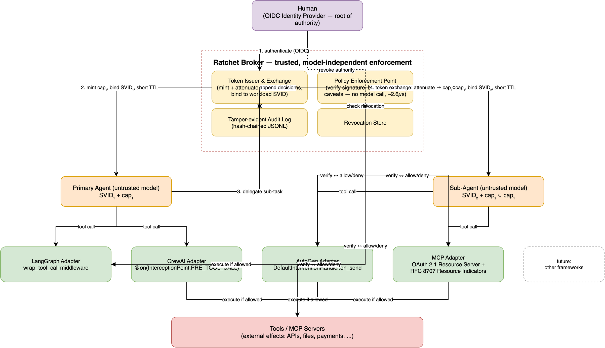

# Ratchet

[](https://github.com/1manideep/ratchet/actions/workflows/ci.yml)

**A capability token can only narrow at each delegation hop — never widen it.**

Ratchet is an open-source authorization broker that sits between LLM agents
and the tools/sub-agents they call, enforcing one invariant: **a fully
prompt-hijacked agent still cannot exceed the authority explicitly delegated
to it.**

This is an open-source reference implementation of the architecture
described in **["Delegation Without Trust: An Empirical Gap Analysis of
Identity, Authorization, and Runtime Governance in Multi-Agent LLM
Systems"](https://arxiv.org/abs/2609.00267)** (Dantuluri & Sundi, VotalAI,
arXiv:2609.00267). The paper's own reference implementation was built and
adversarially evaluated but **not publicly released**; Ratchet provides
one. Ratchet is an independent, MIT-licensed project, not
affiliated with the paper's authors or VotalAI.

## Why

Agent frameworks today hand broad, long-lived bearer credentials to tools
and sub-agents, and let the *model's own reasoning* gate sensitive actions.
That's backwards: the model is the most attackable part of the system. The
paper's evaluation shows a default runtime modeling common framework
practice fails all four core threats of multi-agent delegation, and three
of four popular frameworks (LangGraph, CrewAI, AutoGen) ship no built-in
confinement at all; MCP's OAuth 2.1 authorization profile covers only part
of the gap.

Ratchet closes it with:

- **Macaroon-style capability tokens** — HMAC signature-chained, so caveats
  are append-only: a delegation hop can only narrow scope, never widen it.
- **Sender-constrained, workload-bound tokens** — a stolen token is inert
  off the workload it was issued to.
- **A model-independent Policy Enforcement Point** — `Broker.authorize()`
  is a pure, synchronous, in-process function; the LLM never gates its own
  access.
- **A tamper-evident, hash-chained audit log.**
- **Revocation that cascades** to every token descended from a revoked one.

## Architecture



Editable source: [docs/architecture/ratchet-architecture.drawio](docs/architecture/ratchet-architecture.drawio)
(open in [diagrams.net](https://app.diagrams.net) or the VS Code Draw.io
Integration extension). Also available as
[SVG](docs/architecture/ratchet-architecture.svg) for higher-resolution
embedding.

## Repository structure

```
ratchet/
├── packages/
│   ├── ratchet-core/       # identity, tokens, broker/PEP, audit, revocation
│   ├── ratchet-langgraph/  # wrap_tool_call middleware
│   ├── ratchet-crewai/     # PRE_TOOL_CALL hook
│   ├── ratchet-autogen/    # DefaultInterventionHandler
│   └── ratchet-mcp/        # OAuth 2.1 resource-server ASGI middleware
├── examples/               # one runnable quickstart per framework
└── benchmarks/             # reproduce_paper_numbers.py
```

A `uv` workspace: install only the adapter you need, e.g. `pip install
ratchet-authz-langgraph` (which depends on `ratchet-authz-core` automatically).
`ratchet-authz-core` has **zero third-party runtime dependencies** beyond the
standard library and `cryptography` (used only for Ed25519 workload
identity keys — HMAC/SHA-256 token signing is stdlib `hmac`/`hashlib`).

## Install

```bash
pip install ratchet-authz-core           # the broker alone
pip install ratchet-authz-langgraph      # or your framework's adapter, which brings the core
```

The import names are `ratchet_core`, `ratchet_langgraph`, `ratchet_crewai`, `ratchet_autogen` and `ratchet_mcp`.

From source:

```bash
git clone https://github.com/1manideep/ratchet.git
cd ratchet
uv sync                              # installs every package + dev deps
uv run --package ratchet-authz-core pytest packages/ratchet-core/tests/ -v
```

## Quickstart

Every adapter follows the same three steps: **issue** a root token bound to
the primary agent, **exchange** a narrower, re-bound token for each
sub-agent, and register the adapter so every tool call is **authorized**
against it.

### LangGraph

```python
from ratchet_core import Broker, Ed25519WorkloadIdentity, tool_name_caveat
from ratchet_langgraph import RatchetMiddleware

broker = Broker()
primary = Ed25519WorkloadIdentity("primary-agent")
token = broker.issue(
    human_identity="alice@example.com",
    primary_identity=primary,
    caveats=[tool_name_caveat("read_calendar")],
)

middleware = RatchetMiddleware(
    broker,
    token_resolver=lambda request: token,
    identity_resolver=lambda request: primary,
)

agent = create_agent(model=..., tools=[...], middleware=[middleware])
```

Full runnable example: [examples/langgraph_example.py](examples/langgraph_example.py)

### CrewAI

```python
from ratchet_core import Broker, Ed25519WorkloadIdentity, tool_name_caveat
from ratchet_crewai import register_ratchet_hook

broker = Broker()
primary = Ed25519WorkloadIdentity("primary-agent")
token = broker.issue(
    human_identity="alice@example.com",
    primary_identity=primary,
    caveats=[tool_name_caveat("web_search")],
)

register_ratchet_hook(
    broker,
    token_resolver=lambda ctx: token,
    identity_resolver=lambda ctx: primary,
)
```

Full runnable example: [examples/crewai_example.py](examples/crewai_example.py)

### AutoGen

```python
from ratchet_core import Broker, Ed25519WorkloadIdentity, tool_name_caveat
from ratchet_autogen import RatchetInterventionHandler

broker = Broker()
primary = Ed25519WorkloadIdentity("primary-agent")
token = broker.issue(
    human_identity="alice@example.com",
    primary_identity=primary,
    caveats=[tool_name_caveat("run_python")],
)

handler = RatchetInterventionHandler(
    broker,
    token_resolver=lambda msg, ctx: token,
    identity_resolver=lambda msg, ctx: primary,
)
runtime = SingleThreadedAgentRuntime(intervention_handlers=[handler])
```

Full runnable example: [examples/autogen_example.py](examples/autogen_example.py)

### MCP

```python
from ratchet_core import Broker, Ed25519WorkloadIdentity, resource_caveat, tool_name_caveat
from ratchet_mcp import RatchetASGIMiddleware, authorize_tool_call

broker = Broker()
primary = Ed25519WorkloadIdentity("primary-agent")
token = broker.issue(
    human_identity="alice@example.com",
    primary_identity=primary,
    caveats=[tool_name_caveat("read_file"), resource_caveat(r"https://files\.example\.com/mcp")],
)

app = RatchetASGIMiddleware(mcp_app, broker=broker, identity_resolver=lambda scope: primary)
```

Full runnable example: [examples/mcp_example.py](examples/mcp_example.py)

## Benchmark results

Measured by running `uv run --package ratchet-authz-core python
benchmarks/reproduce_paper_numbers.py` on a 2026-era Apple Silicon laptop —
your hardware will vary; the point is the same order of magnitude as the
paper's ~2.6µs/~5.4µs, negligible against model inference (hundreds of ms
to seconds).

| Metric | Result |
|---|---|
| `authorize()` latency | 9.56 µs/call (~104,600 decisions/sec) |
| `exchange()` latency | 27.4–28.5 µs/call (~35,500 exchanges/sec) |
| Forged/mutated tokens accepted | 0 / 200,000 |
| Blast radius — bearer delegation | 8,100.0 / 8,100 actions (100%) |
| Blast radius — Ratchet delegation | 1.5 / 8,100 actions |

The 11-attack adversarial-robustness suite and the four named-threat
(T1–T4) scenarios are enforced as pytest assertions, not a single number —
see [packages/ratchet-core/tests/test_attacks.py](packages/ratchet-core/tests/test_attacks.py):

```bash
uv run --package ratchet-authz-core pytest packages/ratchet-core/tests/test_attacks.py -v
```

All 21 pass: the default/unguarded bearer-token baseline succeeds at all
four threats (T1 confused deputy, T2 token theft/replay, T3 privilege
escalation, T4 compromised sub-agent) — demonstrating the vulnerability —
and Ratchet blocks all four, plus all 11 direct attacks on the broker's own
design (forgery, caveat stripping/widening, re-binding, replay, malformed
caveats, revoked/expired tokens, depth-limit bypass).

## Design notes worth knowing

- **Caveat narrowing is a deterministic approximation, not SMT-verified**
  (contrast with [Progent](https://arxiv.org/abs/2504.11703)). `tool_name`
  / `arg_constraint` / `resource` caveats are evaluated with AND semantics,
  so any well-formed addition can only shrink the accepted set — no subset
  check needed. `expires_at` and `max_depth` require the new value to
  tighten the existing bound. `bound_to` can only be set via
  `Broker.exchange()`, after verifying the presenting identity holds the
  parent token — never via the public `attenuate()`.
- **`max_depth` caveat** bounds delegation-chain depth — an improvement
  over the paper's design, preventing unbounded delegation chains.
- **No network calls anywhere in the authorization path** — `authorize()`
  and `exchange()` are pure, synchronous, in-process calls. That's what
  makes microsecond-level enforcement possible. A future `ratchet-remote`
  package could add a network-mediated PEP for multi-process deployments
  without changing this API.
- **Identity is self-contained Ed25519 for v0.1**, no SPIFFE/SPIRE
  dependency, behind a `WorkloadIdentity` interface a future
  `ratchet-spiffe` package can implement without touching the broker or any
  adapter.

## Out of scope for v0.1

Real SPIFFE/SPIRE integration, a hosted/remote broker service, a policy
authoring UI, SMT-solver-verified narrowing, enterprise IdP (Okta/Auth0/
Entra) integration, and agent-community-governance features (voting,
dissent preservation) are all explicitly out of scope for v0.1.

## Security

Found a way around the broker's guarantees? Please report it privately: see [SECURITY.md](SECURITY.md).

## License

MIT — see [LICENSE](LICENSE).

## Citation

```bibtex
@misc{dantuluri2026delegation,
  title={Delegation Without Trust: An Empirical Gap Analysis of Identity,
         Authorization, and Runtime Governance in Multi-Agent LLM Systems},
  author={Dantuluri, Panduranga Sai Varma and Sundi, Jyotirmoy},
  year={2026},
  eprint={2609.00267},
  archivePrefix={arXiv},
  primaryClass={cs.CR}
}
```
